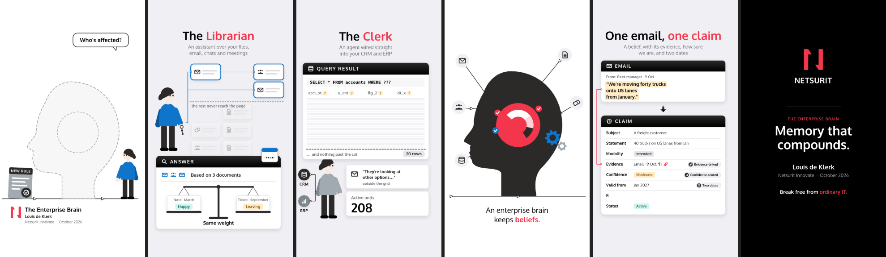
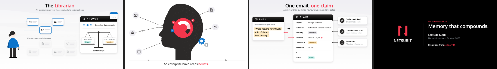

# Netsurit Video

**A Claude Code plugin by [Louis de Klerk](https://github.com/LouisDK) (Netsurit Innovate)** for making Netsurit-branded animated explainer videos by talking to Claude.




These stills are from *The Enterprise Brain* (October 2026), the piece this plugin was distilled from. Its full source ships with the plugin as a worked example.

What you get:

- **The look:** flat infographic illustration in the Netsurit corporate identity (CI): charcoal and Netsurit Red, Oxygen type, the N lockup on a black end card, and a byline that credits you.
- **The voice:** a professional narrator from ElevenLabs. Every on-screen action lands on the word that names it.
- **The music:** composed in code for free, or an optional Eleven Music track.
- **Two shapes from one piece:** 9:16 for WhatsApp (the main send) and 16:9 for decks, LinkedIn and email.
- **Checked before you see it:**
  - no text cut off, overlapping or hidden under the player controls;
  - loudness right for phones;
  - no dead moments;
  - a story that builds to its payoff.

You don't write any code. Claude does, and asks you to approve each stage:

1. **The story:** the script plus a beat table.
2. **The look:** stills in both shapes.
3. **The storyboard:** one panel per beat.
4. **The finished video:** the WhatsApp file and the 16:9 version.

---

## 1. Install the plugin

You need [Claude Code](https://claude.com/claude-code). In Claude Code, run:

```
/plugin marketplace add LouisDK/netsurit-video
/plugin install netsurit-video@netsurit
```

Restart Claude Code if the skills don't appear. You'll have two skills:

| Say something like… | Skill | What it does |
|---|---|---|
| "Set me up for Netsurit videos" | `setup` | Checks your computer, tells you (or runs) what to install, and makes a test video |
| "Make a Netsurit video about …" | `video` | Makes the video with you, step by step |

## 2. Set up your computer (once)

Open Claude Code in an empty folder for your videos (for example `~/videos`) and say **"set me up for Netsurit videos"**. Claude checks the items below and walks you through anything missing, with commands for your operating system:

| What | Why |
|---|---|
| Node.js 18 or later | runs the video tools |
| ffmpeg | encodes the video and audio |
| Playwright with Chromium | draws every frame (in a hidden browser) |
| the Oxygen font | Netsurit's typeface (included; Claude installs it for you) |
| Python with `faster-whisper` | finds the exact time of every spoken word, locally |
| an ElevenLabs API key | the narrator's voice (and, optionally, the music); see below |

- **Windows:** use **WSL2 with Ubuntu**. It's the proven setup. Install it from an admin PowerShell with `wsl --install -d Ubuntu`, restart, then run Claude Code inside Ubuntu and keep your videos folder in the Linux home (`~/videos`).
- **macOS and Linux:** work directly.

Setup ends with a 25-second test video, so you know everything works before you start a real one.

## 3. Your own ElevenLabs account and API key

The narration comes from [ElevenLabs](https://elevenlabs.io). Each person uses their own account, or a shared Netsurit one (ask your manager first).

### Create the account and choose a plan

1. Sign up at [elevenlabs.io](https://elevenlabs.io).
2. **Pick a paid plan for work videos.** Paid plans include a commercial licence; the free plan doesn't cover commercial use.
   - The *Starter* plan made *The Enterprise Brain*: its 3-minute narration plus three music takes.
   - Check [elevenlabs.io/pricing](https://elevenlabs.io/pricing) for current plans and limits.
3. **Know what things cost:**
   - narration is about **1 credit per character** of script (a 90-second script is about 1,300 characters);
   - Eleven Music is about **700 credits per minute per take**;
   - Claude always tells you the count and your balance before it generates anything.

### Create an API key

1. Sign in at [elevenlabs.io](https://elevenlabs.io). Open **Developers** (left sidebar, or your profile menu), then **API Keys**, and click **Create API Key**.
2. Name it, for example `netsurit-video`.
3. If the form offers scoped permissions, enable these:

   | Permission | Needed for |
   |---|---|
   | **Text to Speech** | narration |
   | **Voices** (read) | finding narrators |
   | **User** (read) | showing your credit balance |
   | **Music** | optional, only for Eleven Music tracks |

   You can also set a credit limit on the key, which is a good safety net.
4. **Copy the key now.** ElevenLabs shows it only once; it starts with `sk_`.

### Give the key to the plugin, safely

In your videos folder, create a file called `.env` containing one line:

```
ELEVENLABS_API_KEY=sk_your_key_here
```

- **Keep it out of git:** if the folder is a git repository, add `.env` to `.gitignore`. The plugin's scripts read the key from there and never print it.
- **Never paste the key** into a chat, an email, a document or a commit.
- **If it leaks,** delete the key in ElevenLabs and create a new one.
- **Check it works:** say **"check my Netsurit video setup"**. The report shows whether the key works and how many credits you have left.

### Choose a voice

Claude can search the voices on your account and in the ElevenLabs voice library. It reads one line of your script in two or three of them, and you pick one.

- **George**, the calm British narrator of *The Enterprise Brain*, is a default voice that every account has.
- **A voice from the library** must first be added to **My Voices** in the ElevenLabs app (open it in the Voice Library and click *Add*) before the API can use it.
- **Your own recording** works too: one audio file per line of the script.

## 4. Make a video

In your videos folder, tell Claude what you want, for example:

> Make a Netsurit video explaining our managed SOC service to CFOs, from docs/soc-overview.pdf. About 90 seconds, for WhatsApp and LinkedIn.

Claude asks a few questions first:
- the audience and the one thing they should remember;
- your name, unit and date for the byline;
- the end card's tagline;
- the length;
- the voice;
- music: composed or Eleven Music.

Then it works through these stages, and you approve each one:

| Stage | You see | You say |
|---|---|---|
| Story | the one-line idea, the script, a beat table | approve / change beats / a different angle |
| Look | stills of 2–4 key moments, in both shapes | thumbs up per frame / changes |
| Storyboard | one panel per beat | thumbs up/down by panel number |
| Voice | the character count and your balance, then 2–3 voice samples | which voice |
| Video | the files, the review's results, the weakest shot | what to change |

Your work lives in `pieces/<name>/`. The files to send are in `pieces/<name>/renders/`:

| File | Use |
|---|---|
| `whatsapp.mp4` | **send this in WhatsApp chats** (720×1280, under 16 MB, so WhatsApp barely recompresses it) |
| `whatsapp-hd.mp4` | full 1080×1920, for sending as a document, by email or by Teams |
| `final.mp4` / `final-1920x1080.mp4` | the 16:9 master for decks, LinkedIn and the intranet |

**Before you send it out:** send `whatsapp.mp4` to yourself once as a normal send and once with HD, and watch both on a phone. WhatsApp doesn't publish its compression settings, so this is the one check the tools can't do for you.

**Time:**
- a 60–90-second video takes an afternoon of back-and-forth;
- a 3-minute one like *The Enterprise Brain* takes longer;
- rendering itself is a few minutes.

## 5. Tips

- **Bring the source material:** documents, a deck, a web page. Claude checks every factual claim on screen and lists its source in the piece's `brief.md`.
- **Keep it short:** one idea in 60–90 seconds beats three ideas in three minutes, especially on WhatsApp.
- **Edit by talking:** "make the hook faster", "the Clerk should be on the left", "the music is too loud". The voice is the clock, so changing the script means new voice takes, which cost credits.
- **The CI is built in:**
  - red is kept for the one idea that matters;
  - headings are in sentence case;
  - the logo appears only on the black end card.
  - Claude keeps to the [Netsurit CI guide](plugins/netsurit-video/skills/video/netsurit/ci/Netsurit-CI-Guide.md); ask it to bend a rule only on purpose.

## Troubleshooting

| Symptom | Fix |
|---|---|
| The text looks like Arial, not Oxygen | Say "install the Netsurit fonts", or run `node <plugin>/skills/video/scripts/install-fonts.mjs`, then restart any open browser |
| "Cannot find module playwright" | `npm i -g playwright && npx playwright install chromium` (on Linux/WSL also `sudo npx playwright install-deps chromium`) |
| Voice timing crashes in Python (`metadata_errors`) | `python3 -m pip install --user "av==15.1.0"` (newer PyAV breaks faster-whisper 1.2.1) |
| ElevenLabs says 401 or 403 | the key is wrong, deleted, or missing a permission (see above) |
| Rendering is very slow on Windows | keep the videos folder inside WSL (`~/videos`), not under `/mnt/c/...` |

## Updating

Run `/plugin marketplace update netsurit`, then reinstall or update the plugin from `/plugin`. Improvements to the method land in `plugins/netsurit-video/skills/video/netsurit/playbook.md`.

## What's inside

```
plugins/netsurit-video/
  skills/setup/        prerequisite check, install steps per OS, a test render
  skills/video/        the method Claude follows
    SKILL.md           the flow: intake → story → look → storyboard → build → review → deliver
    netsurit/          brand.js (the CI in code), the CI guide, logos, Oxygen, the playbook, voice/music/WhatsApp guides
    scripts/           check, install-fonts, new-piece, tts (ElevenLabs), music (Eleven Music), whatsapp (encode)
    starter/           the template every new piece starts from (both shapes, voice-led)
    examples/          the full source of The Enterprise Brain, 9:16 and 16:9 (no audio)
    engine/            Animate 0.4 (MIT), the renderer and review tools, with the infographic style
```

## Contributing

Found a layout that works, or a trap to avoid? Each piece's `LOG.md` records what the review caught. Open an [issue](https://github.com/LouisDK/netsurit-video/issues) or a pull request with a one-line rule for the playbook, and everyone gets it on their next update.

## Credits

- **Created by [Louis de Klerk](https://github.com/LouisDK)**, Netsurit Innovate, 2026.
- **Rendering engine:** [Animate](https://github.com/cth9191/animate) by cth9191 (MIT licence).
- **Typeface:** [Oxygen](https://fonts.google.com/specimen/Oxygen) (SIL Open Font License).
- **Brand assets:** the Netsurit name, logos and CI are © Netsurit; use them only as the CI guide allows.

Full notices: [`plugins/netsurit-video/NOTICE.md`](plugins/netsurit-video/NOTICE.md).
