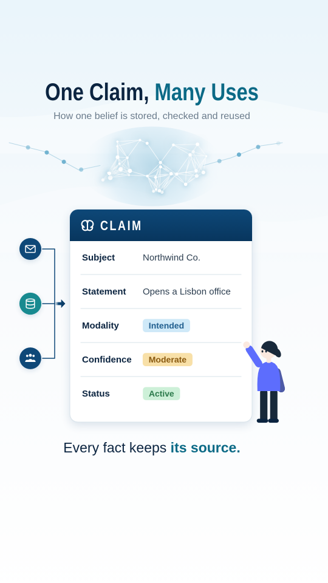

# Infographic (flat vector)

Corporate flat-vector illustration and clean infographic cards, on one palette. Two moods a piece can move between:

- **Illustration** on white: a big saffron hero mass (a head in profile) with speckled grain toward one side, a cream disc inside it, periwinkle and navy figures and charts, navy hairline flow loops with hollow arrowheads, gears, speech bubbles that type, check circles, circuit traces, a ladder.
- **Infographic sheet** on a pale blue wash: a two-tone condensed headline (navy + teal), white rounded cards with soft blue shadows, navy header bands, round icon badges, pastel pills, connectors with dots, solid chevron arrows, and a glowing node network.

Motion on 1s: everything pops in on a spring, lines draw on, arrowheads travel, gears turn, network nodes twinkle, then the frame holds. Studied from two local stills: a flat corporate illustration and an AI-made infographic. The reference media is kept in `references/`, which is gitignored, and was never copied.

## Measured (from the references; region medians, 8-level buckets)

| what | reference | this style (`IG` in kit.js) |
|---|---|---|
| ground (illustration) | `#fefffe`, 62% of the picture | `#ffffff` |
| hero mass | `#ffc25c` / `#fdc45f`, 12% (the head) | `saffron #fdc35e` |
| grain on the mass | darker saffron speckle, back of the head only | `saffronD #e3952e`, 14k dots, ramped toward `dir` |
| inner disc | `#fbebe3` | `cream #fbe9df` (also skin) |
| periwinkle family | `#5d6dfd`, `#8c99df`, `#4d61a6` | `peri #5d6dfd`, `lav #8c99df`, `indigo #4d5aa6` |
| navy ink | `#18293a` (trousers, hair, hairlines, dark slices) | `ink #18293a` |
| hairlines | ~1.5px on a 1280px picture | `IG_HAIR` 3px at 1080 wide |
| sheet ground | `#f8fbfd` 53%, `#eaf5fa` 17%, `#d6ebf5` 5% (a vertical wash with soft white waves) | `washL / wash / washD`, gradient + 3 drifting white bands |
| header bands, badges | `#105080` → `#003868` | `navy #0e4878` → `navyD #08365e` |
| title | navy `#002040` + teal `#005880`, condensed bold, about 5% of picture width per cap height | `navyT #0b2440` + `tealT #0b6a86`, `IGHEAD` 700 |
| accent badge | teal `#188890` | `teal #188a90` |
| network glow | `#98c0d8`, `#88b0d0`, cyan core `#6cb0cf` | white nodes, `cyan #6cb0cf` glow, radial wash |
| pills | blue `#c8e8f8`, yellow `#f8e0a8`, green `#c8f0d8` | `pillB/Y/G` plus darker text of the same hue |
| card | white, border `#d0d8e0`, soft blue shadow | white, `rule #d8e3ea` 2px, shadow `rgba(30,80,130,.16)` blur 30 dy 10 |

## Palette and meaning

- **Saffron** is the hero mass: one big shape per illustration frame. Never use it for text.
- **Periwinkle family** is for people (shirts) and data (bars, donut slices, gears). Navy ink is for lines, hair, trousers and dark slices.
- **Navy** is for structure on the sheet (headers, badges, connectors, title). **Teal** is for the second half of a title, one accent badge and caption emphasis.
- **Pills** carry states: blue for a kind, yellow for "moderate / pending", green for "active / done".

## Type

- `IGHEAD`, condensed bold: titles, header labels (tracked), step tags (uppercase). Fallbacks: Bahnschrift, Avenir Next Condensed, Arial Narrow, Liberation Sans Narrow.
- `IGSANS`: body, row labels (700), values (400), captions (500, centred at `CX`, navy with one emphasis run).
- Sizes at 1080 wide: title 80, subtitle 32, caption 46, row 30, pill 28, step tag 34.

## Motion habits

- On 1s (`ones: true`). Every entrance runs on a closed-form spring:
  - `igPop` for icons, pills, bubbles and checks (a little overshoot)
  - `igSettle` for cards, the head and captions (almost none)
  - `igDraw` for lines and write-ons (ease in-out)
- Stagger every group: rows 0.1 s apart, pills 0.25 s, bars 0.09 s, sources 0.12 s.
- Idle life once things land:
  - arrowheads travel along flow lines
  - gears turn in opposite directions
  - bubble dots bounce
  - network nodes twinkle in a wave
  - the wash drifts
  - the donut turns slowly
  - the hero breathes and blinks
- Camera: still, or a slow push of 3% or less.
- Morphs: a flat fill with a soft shadow on white paper. The window is a card: a shadow, a 6px white rim and a hairline border. Use a disc to card or a badge to card (similar proportions).

## Frame checklist (on top of grammar/FRAME.md)

1. **One mood per frame:** illustration on white *or* sheet on wash. Don't put cards on the illustration, or the head on the sheet.
2. **Illustration:** one saffron mass dominates (35–55% of the frame width), with its grain on one side only. Small props orbit it, and flow lines pass *behind* it.
3. **Sheet:** a two-tone title at the top, one hero card in the middle, and sources or callouts joined to it by connectors. Every card has a shadow and a hairline border.
4. **Flat:** no outlines on filled shapes. The only gradients allowed are the wash, the header bands, the chevron and the network glow. Hairlines appear only on line-art props (bubbles, outline gears, bulb, flows, ladder).
5. **Colour has a job** (see Palette): saffron is never text, and pills always mean a state.
6. **Everything enters on a spring, staggered**, and then holds with only small idle life.
7. **White space:** content within x 60–940 and y 250–1500 on 9:16. The caption sits on its own line under the art.

## Kit API (`kit.js`, on top of `kit/core.js`; everything is prefixed `ig`)

- **Motion:** `igSpring(t0, {k, damp})`, `igPop(t0)`, `igSettle(t0)`, `igDraw(t0, d)`, `igAt(x, y, k, fn, alpha)` (scale about a point).
- **Drawing basics:** `igPath`, `igFill(P, c)`, `igLine(c, w)`, `igShadow(fn, o)`, `igBez(start, segs)` (cubic outline sampler).
- **Text:** `igText(str, x, y, size, c, {weight, font, align, frac, track})`, `igRich(segs, …)`, `igTitle(segs, x, y, size, p)`, `igW`, `igSkel(x, y, w, n, p)` (placeholder lines).
- **Sheet:**
  - backgrounds and panels: `igWash()`, `igCard(x, y, w, h, p, {r})`, `igHeader(x, y, w, h, p, {label, icon})`
  - labels: `igBadge(x, y, r, icon|number, p, {fill, ring})`, `igPill(str, x, y, size, 'b'|'y'|'g', p)`, `igStep(n, label, x, y, size, p)`
  - links and flow: `igConnector(P, p, {dots, dash})`, `igChevron(x, y, s, p, dir)`, `igNetwork(cx, cy, rx, ry, p, {key, n})`, `igStream(P, p, {n, speed})`
- **Illustration:**
  - the mass: `igHead(x, y, s, {dir, grain})`, `igHeadPts`, `igGrain(P, c, {dir, n})`
  - lines: `igFlow(P, p, {arrows, speed, phase})`, `igCircuit(x, y, lens, p)`, `igLadder(x0, y0, x1, y1, w, p)`
  - props: `igGear(x, y, r, n, rot, {fill|line})`, `igBubble(x, y, w, h, p, {tail})`, `igCheck(x, y, r, c, p)`, `igBulb(x, y, s, p)`
  - charts: `igBars(x, y, w, h, vals, p, {t0})`, `igDonut(x, y, r0, r1, segs, p, rot)`
- **Icons:** `igIcon(name, x, y, s, c)` for `mail db people doc chart link clock bulb search gear check brain ticket`.
- **Hero:** `igPerson(x, feetY, height, {key, look: ±1, hop, wave})` is a flat figure: periwinkle top, navy trousers and hair, cream face, two tiny blinking eyes. It sets `SPARK_AT`.
- **Captions:** `igCaption(segs, {y})` and `igTag(n, label)` both draw through `DEFER`.
- **Variant:** `const IG_SHEET = true;` before the kit makes the morph paper the pale wash.

## Do / don't

- **Do** draw flow lines and connectors before the masses they pass behind.
- **Do** use the illustration for the *problem / people* beats and the sheet for the *structure / answer* beats. The disc-to-card morph is the natural bridge between them.
- **Don't** add outlines to flat fills, or drop shadows to illustration shapes (only cards, badges and the morph shape get shadows).
- **Don't** put more than three pill colours, or more than one teal accent, in a frame.

## Not matched (deliberate or open)

- **Figures:** the reference's people are fully posed (sitting, climbing, carrying laptops). `igPerson` stands, hops and waves only, and adds eyes the reference doesn't have.
- **Illustration props:** the reference's monitor, tablet, folder and R&D magnifier bubble are not primitives. Use `igIcon` inside `igCard` or `igBadge`.
- **The infographic's rendered 3D brain** (glassy, volumetric) is simplified to a flat glowing node network.
- **Fonts:** the title face in the reference is a custom condensed grotesque. We use system condensed fonts, so the look varies a little by OS.

## Proven on

`demo/` (6 s, 9:16, 30 fps, 120 BPM):

- **Era 1:** a saffron head rises in; flows, gears, a donut, bars, bubbles and checks pop around it; the hero hops at the ladder.
- **At 3.0 s:** the cream disc morphs into a white card.
- **Era 2:** on the pale blue sheet, the title writes on, the network glows, the CLAIM header, rows and pills pop in, the sources connect, and the hero waves.

The tile is deterministic. No full piece has used this style yet.
